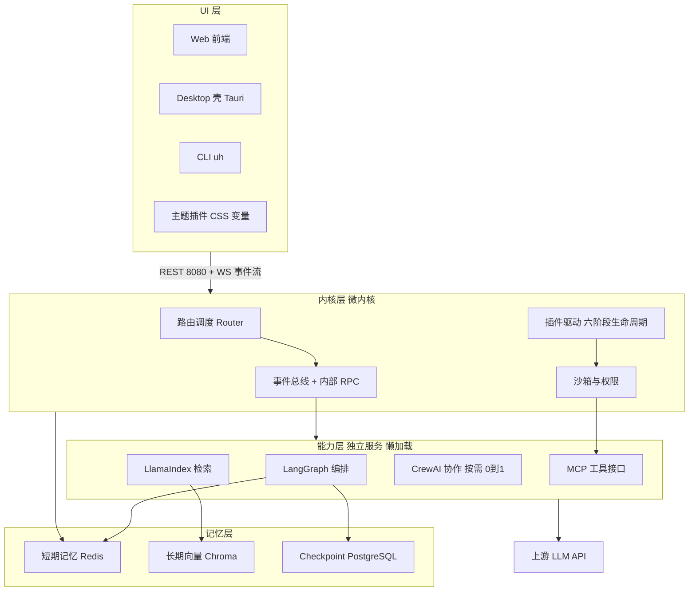
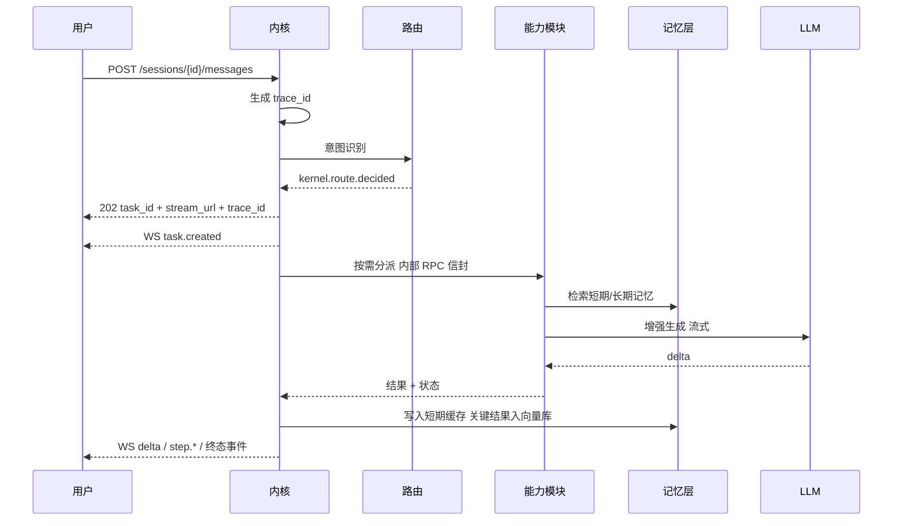
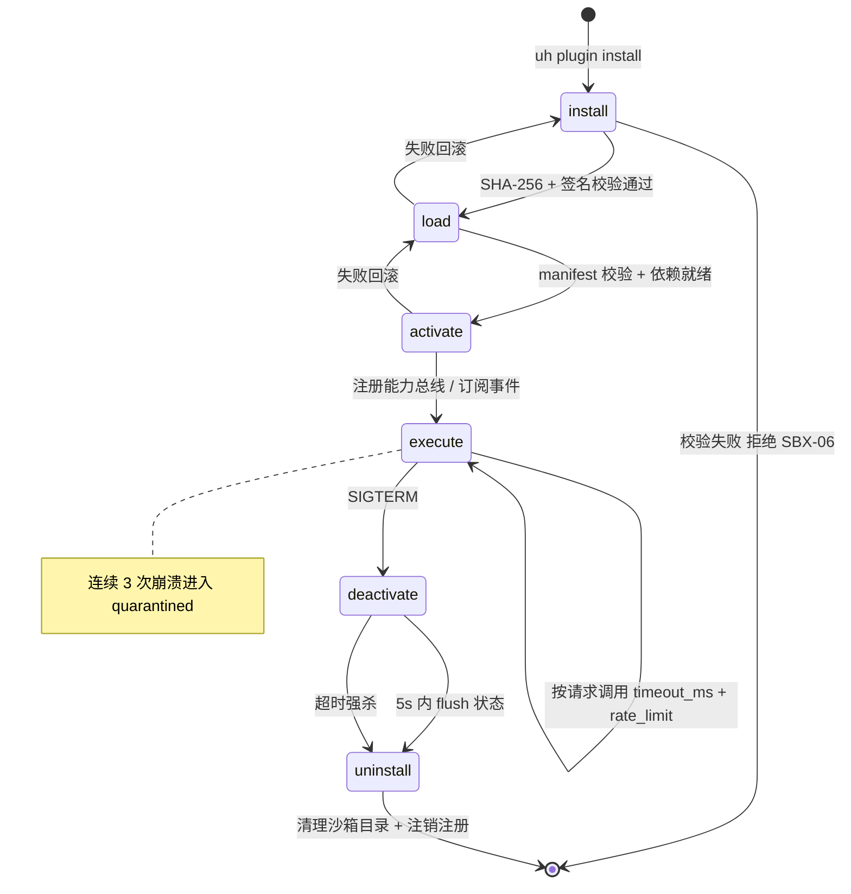
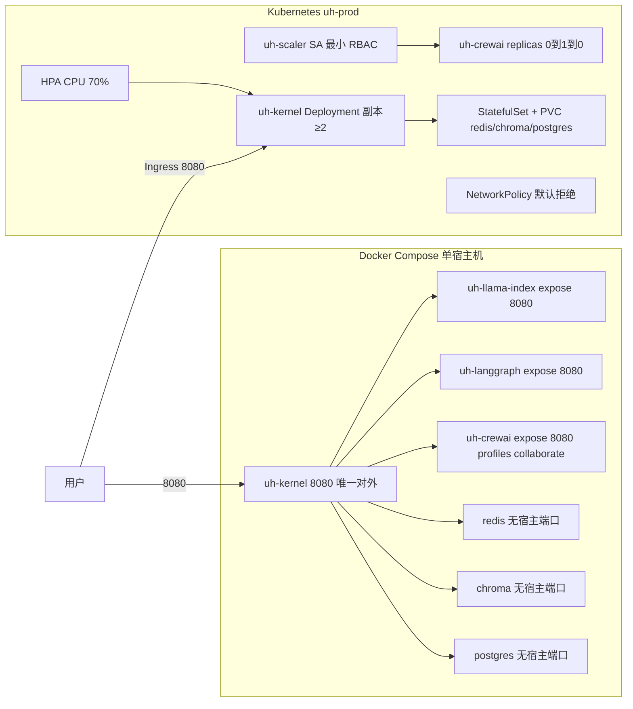

# P0-6 契约图集（4 张 Mermaid，GitHub 原生渲染）

> 对应 v3 §3.1 分层模型 / §3.4 请求生命周期 / §5.3 插件生命周期 / §7.x 部署拓扑。
> 事实源：本图集与 openapi.yaml / asyncapi.yaml / events.md 同批评审；修改走契约 PR 流程。

## 1. 分层模型（§3.1 / §3.2）

## 2. 请求生命周期（§3.4，含 trace_id 与事件流）

## 3. 插件生命周期（§5.3，任一阶段失败幂等回滚）

## 4. 部署拓扑（§7.x，暴露面契约见 deploy-hardening.md）

