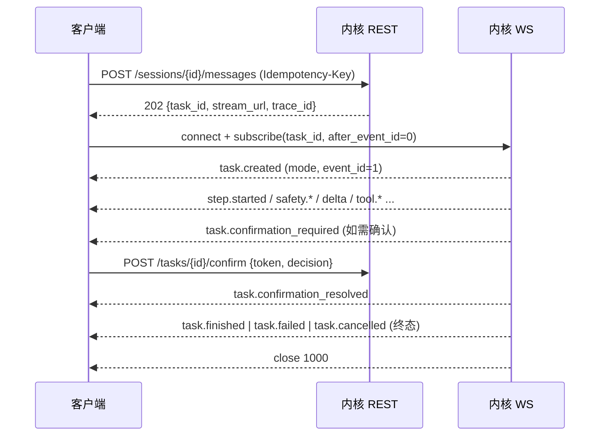

# P0-3 契约：REST→WS 任务流闭环

> 版本：v0.1.0（契约已冻结）· 状态：frozen（MS-0 评审通过 2026-11-15，tag contract-v0.1.0；只增不改）
> 基线：v3 整合版 §6.3.1 / §6.3.2 / §6.4（L456-575）· 关联：errors.md（P0-1）、events.md / events.schema.json（事件字典）、ui-state-machine.md
> 范围：POST messages 响应定义、WS 连接/鉴权/重连、任务终态、确认与取消/恢复端点、回放回退。

## 1. 发送消息 → 任务句柄

POST /api/v1/sessions/{id}/messages（请求体见 v3 §6.3.1，支持 Idempotency-Key）

同步返回 202 Accepted（决议 F1：任务异步执行，202 语义准确；响应包裹遵循 §6.2）：

```json
{
  "data": {
    "task_id": "uh_task_7f3a9c...",
    "stream_url": "wss://<host>/api/v1/stream?task_id=uh_task_7f3a9c...",
    "trace_id": "uh_trc_9c8d..."
  },
  "meta": { "trace_id": "uh_trc_9c8d..." },
  "error": null
}
```

- task_id：uh_task_ 前缀（§6.2 ID 规范）；stream_url：客户端据此建立事件流连接。
- M0 过渡（决议 F2）：M0 最小版可返回 SSE 端点（https://.../api/v1/tasks/{id}/stream），客户端按 scheme 区分 wss/ws 与 https；契约字段形状不变，M1-7 起统一 WS。
- 失败：会话不存在/非法 → UH-USR-1003；未认证 → UH-USR-1001；限流 → UH-USR-1004（errors.md）。

## 2. WebSocket 连接与鉴权

连接：wss://<host>/api/v1/stream?task_id=<id>[&after_event_id=<n>]

- 鉴权：Bearer token 经 query 参数 token 或首条 op:auth 消息携带；本地模式可关闭（§6.2）。
- 订阅：{ "op": "subscribe", "task_id": "...", "after_event_id": 0 }；after_event_id=0 表示从头播放。
- 心跳：{ "op": "ping", "ts": <unix秒> } → 服务端 { "op": "pong", "ts": <unix秒> }。
- 归属校验：订阅他人 task_id → 推送错误帧 { "op": "error", "error": { "code": "UH-USR-1002", ... } } 并关闭（close 4403）（SEC-04）。

关闭码（决议 F3，新增约定）：

| close code | 含义 | 客户端动作 |
|---|---|---|
| 4401 | 未认证（UH-USR-1001） | 重新认证后重连 |
| 4403 | 无权订阅（UH-USR-1002） | 不重连，提示用户 |
| 4404 | task 不存在（UH-USR-1003） | 不重连 |
| 4408 | 回放窗口过期 | 回退拉取 /tasks/{id}/steps |
| 1000 | 任务终态后正常关闭 | 不重连 |

## 3. 事件流与终态

- 所有服务端事件统一信封：event_id / event / version / task_id / trace_id / ts / payload（span_id 可选，审计反查），定义见 events.md §2。
- 事件字典 18 个（5 类），只增不改；载荷 schema 见 events.schema.json。
- 终态（决议 F4）：task.finished / task.failed / task.cancelled 三者必居其一且仅居其一，是任务的最后一个事件；终态事件必须送达（持久化至任务 TTL），终态后服务端主动 close 1000。
- 确认拒绝 → task.cancelled（reason=confirmation_rejected，error.code=UH-USR-1002），保留已完成步骤（对齐 M1-8 / events.md 决议 C5）。

## 4. 确认 / 取消 / 恢复端点（契约形状，M1-8 / M1-4 实装）

| 端点 | 请求体 | 响应 data | 说明 |
|---|---|---|---|
| POST /tasks/{id}/confirm | { confirmation_token, decision: "approved"\|"rejected" } | { call_id, decision } | token 一次性防重放；过期 → UH-USR-1003；重复提交 → UH-USR-1003 |
| POST /tasks/{id}/cancel | { reason?: string } | { task_id, status: "cancelling" } | 触发 task.cancelled（reason=user_request） |
| POST /tasks/{id}/resume | { checkpoint_id?: string } | { task_id, resumed_from_event_id } | 触发 task.resumed；不重复执行已完成节点（E2E-04） |

confirm 端点为 P0-3 新增契约（v3 §6.3.2 仅有 cancel/resume）；CLI / REST / Web 三端共用，确认不再只在 UI 层成立（M1-8 背景）。

## 5. 断线重连与回放

1. 客户端持久化最后收到的 event_id，重连时带 after_event_id=N（兼容别名 last_event_id，deprecated_in v0.1.0，v0.2.0 移除）。
2. 服务端重放 (N, latest] 区间事件；event_id 任务内单调递增无空洞，客户端发现空洞即请求全量重放。
3. 终态保证：重连时任务已终态 → 直接推终态事件（含 final_result / error），不再重放中间事件。
4. 回放窗口默认 5 分钟（对齐 v3 §6.4）；超窗：服务端发 { "op": "replay_unavailable", "reason": "window_expired" } 并 close 4408，客户端回退 GET /tasks/{id}/steps 全量重建阶段视图 + GET /tasks/{id} 取终态。
5. steps[].seq 与该步骤 step.started 的 event_id 对齐（决议 C8），两路数据可合并；窗口外 delta 级细粒度内容不回放，最终内容在 final_result / 消息列表。
6. 审计反查：内部信封 event_id（bus_seq）+ 外部信封 span_id + trace_id 三级关联（§9.8 溯源链，M1-1 实装）。

## 6. 端到端时序



## 7. 决议记录

| # | 决议 | 理由 |
|---|---|---|
| F1 | POST messages 返回 202 + 任务句柄 | 异步任务语义；v3 未定义响应，P0-3 补齐 |
| F2 | M0 允许 SSE 过渡，stream_url 按 scheme 区分 | M0-5 风险约定"先简单流式"，契约形状不变 |
| F3 | WS 关闭码 4401/4403/4404/4408/1000 | v3 无关闭码定义；错误码对齐 errors.md |
| F4 | 终态三选一且必送达，终态后 close 1000 | 提案"终态保证"落地；UI 状态机吸收态依赖此保证 |
| F5 | confirm 端点进 P0-3 契约 | M1-8 要求 CLI/REST 可确认，端点形状须先冻结 |
