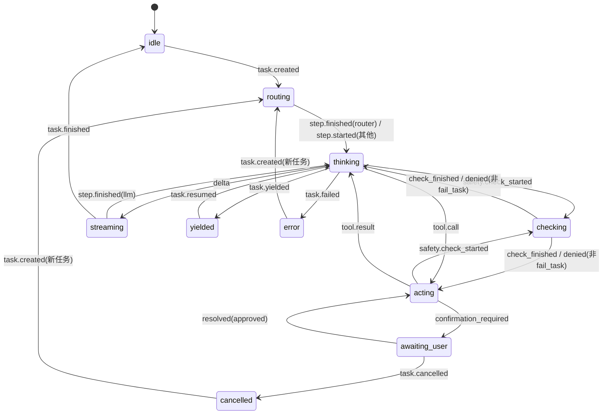

# P0-3 契约：UI 状态机（事件驱动 Agent Status）

> 版本：v0.1.0（契约冻结候选）· 状态：needs-review
> 关联：events.md（18 事件）、task-flow.md（终态保证）· 实装：M1-9（Web 接入）、M3-6（Desktop 共用）
> 原则：前端只消费事件、按表迁移状态，不自己推断（Coopanion"事件驱动 UI"同款思路）。

## 1. 状态集（10 个）

idle / routing / thinking / checking / acting / streaming / awaiting_user / yielded / error / cancelled

- checking 携带 return_state（thinking | acting），检查结束回到来源状态。
- degraded 是正交标记而非状态：task.degraded 置位，终态清除，UI 以徽标展示（决议 C10）。
- error / cancelled 为终态展示态，可被新任务 task.created 重置，或用户本地关闭。

## 2. 转移表（覆盖全部 18 事件）

| from | on | guard | to | 说明 |
|---|---|---|---|---|
| idle | task.created | — | routing | 路由判定完成，阶段条开始 |
| routing | step.finished | module=router | thinking | 内核在 task.created 后补发 router 步骤事件 |
| routing | step.started | module≠router | thinking | 直接进入能力阶段 |
| thinking | safety.check_started | — | checking | return_state=thinking |
| acting | safety.check_started | — | checking | return_state=acting（工具参数风险检查） |
| checking | safety.check_finished | return_state=thinking | thinking | |
| checking | safety.check_finished | return_state=acting | acting | |
| checking | safety.denied | action_taken≠fail_task | 回 return_state | 剔除内容/拦截工具后继续；fail_task 时等 task.failed |
| thinking | step.started / step.finished / step.failed | — | thinking | 阶段条更新，状态不变 |
| thinking | tool.call | — | acting | |
| acting | tool.result | — | thinking | |
| acting | step.failed | module=mcp_tool | thinking | 工具步骤失败，内核决定重试/降级/终态 |
| acting | task.confirmation_required | — | awaiting_user | 确认发生在 tool.call 之后（顺序约束 §5.4） |
| awaiting_user | task.confirmation_resolved | decision=approved | acting | 工具继续执行，等 tool.result |
| awaiting_user | task.confirmation_resolved | decision=rejected | awaiting_user | 等 task.cancelled 终态吸收 |
| awaiting_user | task.confirmation_required | 新 call_id | awaiting_user | 多工具连续确认 |
| thinking | delta | — | streaming | |
| streaming | delta | — | streaming | 自环 |
| streaming | step.finished | module=llm | thinking | 流式结束 |
| any | task.degraded | — | 不变 | 置 degraded 标记 |
| any | task.yielded | — | yielded | CUA 让位（预留） |
| yielded | task.resumed | — | thinking | 恢复执行 |
| any | task.finished | — | idle | 终态吸收，清 degraded |
| any | task.failed | — | error | 终态吸收，展示 error.code 文案（errors.md 域策略） |
| any | task.cancelled | — | cancelled | 终态吸收，展示 reason |
| error / cancelled | task.created | 新任务 | routing | 重置 |

未列出的 (状态, 事件) 组合：仅记录日志，不迁移、不报错（事件只增不改的前向兼容）。

## 3. 机器可读定义（合法 YAML，转移列表无重复键）

```yaml
state_machine:
  initial: idle
  orthogonal_flags: [degraded]
  states: [idle, routing, thinking, checking, acting, streaming, awaiting_user, yielded, error, cancelled]
  transitions:
    - { from: idle,          on: task.created,                to: routing }
    - { from: routing,       on: step.finished,               to: thinking, guard: "module == router" }
    - { from: routing,       on: step.started,                to: thinking, guard: "module != router" }
    - { from: thinking,      on: safety.check_started,        to: checking, set: "return_state = thinking" }
    - { from: acting,        on: safety.check_started,        to: checking, set: "return_state = acting" }
    - { from: checking,      on: safety.check_finished,       to: thinking, guard: "return_state == thinking" }
    - { from: checking,      on: safety.check_finished,       to: acting,   guard: "return_state == acting" }
    - { from: checking,      on: safety.denied,               to: thinking, guard: "return_state == thinking && action_taken != fail_task" }
    - { from: checking,      on: safety.denied,               to: acting,   guard: "return_state == acting && action_taken != fail_task" }
    - { from: thinking,      on: tool.call,                   to: acting }
    - { from: acting,        on: tool.result,                 to: thinking }
    - { from: acting,        on: step.failed,                 to: thinking, guard: "module == mcp_tool" }
    - { from: acting,        on: task.confirmation_required,  to: awaiting_user }
    - { from: awaiting_user, on: task.confirmation_resolved,  to: acting,   guard: "decision == approved" }
    - { from: thinking,      on: delta,                       to: streaming }
    - { from: streaming,     on: step.finished,               to: thinking, guard: "module == llm" }
    - { from: any,           on: task.yielded,                to: yielded }
    - { from: yielded,       on: task.resumed,                to: thinking }
    - { from: any,           on: task.finished,               to: idle }
    - { from: any,           on: task.failed,                 to: error }
    - { from: any,           on: task.cancelled,              to: cancelled }
    - { from: error,         on: task.created,                to: routing }
    - { from: cancelled,     on: task.created,                to: routing }
```

## 4. 状态图



## 5. 实现规则

1. 前端不得从 delta 内容、耗时或轮询推断状态；一切迁移以事件为准。
2. 终态吸收后忽略该任务后续事件（终态保证见 task-flow.md §3）；新任务以 task.created 重置。
3. event_id 空洞 → 请求重放；超窗回退时用 /tasks/{id}/steps（seq=event_id 对齐）重建阶段条，再按终态事件落位。
4. 未知事件（未来新增）：记日志不迁移，保证只增不改的前向兼容。
5. 本地 UI 动作仅限关闭 error/cancelled 展示，不产生业务状态。
6. Web 与 Desktop 共用本表（M3-6 验收：功能一致性 ≥95%）；桌宠动画/气泡由同一状态机驱动（M3-6 扩展位）。
7. 对提案的修正（决议 C10 延伸）：confirmation_required 发生在 tool.call 之后，故 awaiting_user 从 acting 进入而非 thinking；提案 YAML 重复键（thinking×3 / any×2）已重写为转移列表。
