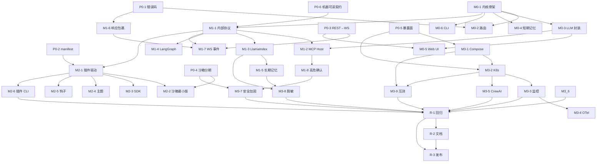

# UH! v0.1.0 任务拆分与 GitHub Issues 交付包

> 版本：1.0 · 适用仓库：`your-org/uh`
> 对应架构文档：`UH!架构设计文档_v0.1.0.docx`
> 计划基线：20 周（M0 3 周 + M1 5 周 + M2 5 周 + M3 7 周 + 缓冲 1 周，含契约周）
> 任务总数：38 个（P0×6 / M0×6 / M1×8 / M2×6 / M3×9 / R×3）

---

## 目录

- [1. 交付包结构](#1-交付包结构)
- [2. Labels 定义](#2-labels-定义)
- [3. Milestones 定义](#3-milestones-定义)
- [4. Issue 总表](#4-issue-总表)
- [5. 依赖关系图](#5-依赖关系图)
- [6. Issue 正文（38 个）](#6-issue-正文38-个)
- [7. GitHub Issue 模板](#7-github-issue-模板)
- [8. 批量创建脚本](#8-批量创建脚本)
- [9. 使用步骤](#9-使用步骤)
- [10. Projects 看板建议](#10-projects-看板建议)
- [11. 验收门禁速查](#11-验收门禁速查)
- [12. 砍需求顺序](#12-砍需求顺序)

---

## 1. 交付包结构

```
uh-issues/
├── README.md                  # 本文档
├── labels.sh                  # 批量创建 labels
├── milestones.sh              # 批量创建 milestones
├── create-issues.sh           # 批量创建 issue + 回填依赖编号
├── issues.csv                 # issue 元数据（可选，供人工核对）
└── issues/
    ├── P0-1.md ... P0-6.md
    ├── M0-1.md ... M0-6.md
    ├── M1-1.md ... M1-8.md
    ├── M2-1.md ... M2-6.md
    ├── M3-1.md ... M3-9.md
    └── R-1.md  ... R-3.md
```

**约定**：
- Issue 编号前缀与架构文档章节对应：`P0` 契约、`M0`~`M3` 里程碑、`R` 发布。
- 依赖使用 `#{{ID}}` 占位，由 `create-issues.sh` 第二轮自动替换为真实 `#编号`。
- 所有正文只依赖 Markdown，不依赖 Word/PDF。

---

## 2. Labels 定义

| 组 | Label | 颜色 | 说明 |
|---|---|---|---|
| 类型 | `type/contract` | `5319e7` | 契约、schema、接口定义 |
| 类型 | `type/feature` | `0e8a16` | 新功能 |
| 类型 | `type/security` | `b60205` | 安全加固 |
| 类型 | `type/infra` | `1d76db` | 部署、CI、监控 |
| 类型 | `type/docs` | `c5def5` | 文档 |
| 领域 | `area/kernel` | `fbca04` | 路由、插件驱动、总线、沙箱 |
| 领域 | `area/capability` | `d4c5f9` | 检索、编排、协作、记忆 |
| 领域 | `area/ui` | `f9d0c4` | Web / Desktop / 主题 |
| 领域 | `area/ops` | `bfd4d7` | CLI、Compose、K8s、监控 |
| 优先级 | `P0` | `b60205` | 阻塞，必须本周 |
| 优先级 | `P1` | `d93f0b` | 本里程碑必须 |
| 优先级 | `P2` | `fef2c0` | 可延后 |
| 规模 | `size/S` | `ededed` | ≤1 天 |
| 规模 | `size/M` | `d4c5f9` | 2-3 天 |
| 规模 | `size/L` | `5319e7` | 4-5 天，需拆 |
| 状态 | `blocked` | `000000` | 有依赖未关闭 |
| 状态 | `needs-review` | `7057ff` | 待契约评审 |
| 状态 | `flaky` | `e99695` | 测试不稳定，限期修 |

---

## 3. Milestones 定义

| Milestone | 标题 | 周期 | 出口标准 |
|---|---|---|---|
| MS-0 | 契约冻结周 | W1 | P0 全部关闭，`docs/contracts/` 评审通过 |
| MS-1 | M0 骨架期：最小闭环 | W2-W4 | chat/search 流式对话，trace_id 可查，路由准确率 ≥90% |
| MS-2 | M1 能力期：模块拆分 | W5-W9 | RAG + MCP + LangGraph resume + WS 事件，内部协议冻结 |
| MS-3 | M2 插件期：可插拔生态 | W10-W14 | 装/卸插件不重启，沙箱拦截演示，SDK 可用 |
| MS-4 | M3 生产期：可运维多形态 | W15-W21 | K8s 单模块故障不中断，100 并发错误率 <1% |
| MS-5 | 缓冲与 v0.1.0 发布 | W22 | 回归通过，发布包 + CHANGELOG |

---

## 4. Issue 总表

### MS-0 契约冻结周（6）

| ID | 标题 | Labels | 依赖 | 验收要点 |
|---|---|---|---|---|
| P0-1 | 统一错误码事实源 | `type/contract` `area/kernel` `P0` `size/M` | — | 解决 LLM 域冲突、KRN-1001/2001 二义、CAP-5021 过粗 |
| P0-2 | 四类插件 manifest schema | `type/contract` `area/kernel` `P0` `size/M` | — | 补 `risk_level`、签名策略，JSON Schema |
| P0-3 | REST→WS 任务流闭环 | `type/contract` `area/kernel` `area/ui` `P0` `size/M` | — | 返回 `task_id + stream_url`，事件带 `trace_id/event_id` |
| P0-4 | 沙箱分期与平台矩阵 | `type/contract` `area/kernel` `P0` `size/S` | — | M2/M3 分期，Linux/macOS/Windows 矩阵 |
| P0-5 | 部署暴露面与 RBAC 收紧 | `type/contract` `area/ops` `P0` `size/S` | — | Compose 改 `expose`，K8s 最小 RBAC |
| P0-6 | 机器可读契约与图 | `type/contract` `type/docs` `P0` `size/M` | P0-1~4 | OpenAPI、AsyncAPI、Schema、Mermaid |

### MS-1 M0 骨架期（6）

| ID | 标题 | Labels | 依赖 | 验收要点 |
|---|---|---|---|---|
| M0-1 | 内核骨架：事件接收 + trace_id + 统一日志 | `type/feature` `area/kernel` `P1` `size/M` | P0-1 | 日志能串起一次请求 |
| M0-2 | 规则版路由（chat/search/tool） | `type/feature` `area/kernel` `P1` `size/M` | M0-1 | 100 条样本准确率 ≥90% |
| M0-3 | LLM 调用封装：流式、超时重试、Token 统计 | `type/feature` `area/kernel` `P1` `size/M` | M0-1 | 流式完整，Token 指标上报 |
| M0-4 | Redis 短期记忆 + 滑动窗口 | `type/feature` `area/capability` `P1` `size/M` | M0-1 | 20 轮不丢上下文 |
| M0-5 | Web UI 最小版 | `type/feature` `area/ui` `P1` `size/M` | M0-3 | Prompt-bar-first + 流式渲染 |
| M0-6 | CLI `uh dev up/down/logs/reset` | `type/infra` `area/ops` `P1` `size/M` | M0-1 | 一键启动本地全模块 |

### MS-2 M1 能力期（8）

| ID | 标题 | Labels | 依赖 | 验收要点 |
|---|---|---|---|---|
| M1-1 | 内部 RPC + 事件总线 + 统一信封 | `type/feature` `area/kernel` `P1` `size/L` | M0-1, P0-6 | **关闭即冻结 6.6** |
| M1-2 | MCP Host：tools/list / tools/call | `type/feature` `area/capability` `P1` `size/M` | M1-1 | web-search 跑通，超时/截断生效 |
| M1-3 | LlamaIndex 独立服务 + 向量库 | `type/feature` `area/capability` `P1` `size/L` | M1-1 | 500 篇召回 ≥70% |
| M1-4 | LangGraph 状态机 + Checkpoint | `type/feature` `area/capability` `P1` `size/L` | M1-1 | resume 不重复执行 |
| M1-5 | 长期记忆写入 + 语义召回 | `type/feature` `area/capability` `P1` `size/M` | M1-3 | L3 拒入库，L2 加密 |
| M1-6 | 错误码体系 + 统一响应包裹 | `type/feature` `area/kernel` `P1` `size/S` | P0-1 | `{data, meta, error}` |
| M1-7 | WebSocket 流式事件 | `type/feature` `area/kernel` `area/ui` `P1` `size/M` | P0-3, M1-1 | 断线重放 |
| M1-8 | 高危工具确认 API 雏形 | `type/security` `area/kernel` `P1` `size/S` | M1-2 | `pending_confirmation` + token |

### MS-3 M2 插件期（6）

| ID | 标题 | Labels | 依赖 | 验收要点 |
|---|---|---|---|---|
| M2-1 | 插件驱动：manifest + 六阶段生命周期 | `type/feature` `area/kernel` `P1` `size/L` | P0-2, M1-1 | 装/卸不重启 |
| M2-2 | 沙箱最小版 | `type/security` `area/kernel` `P1` `size/L` | P0-4, M2-1 | SBX-01~05 通过 |
| M2-3 | 工具插件 Python SDK + 3 个官方工具 | `type/feature` `area/kernel` `P1` `size/L` | M2-1, M1-2 | 30 分钟写出插件 |
| M2-4 | 主题插件 CSS 契约 + 一键切换 | `type/feature` `area/ui` `P2` `size/M` | M2-1 | 200ms 生效，无 JS 注入 |
| M2-5 | 钩子插件 + 审计日志示例 | `type/feature` `area/kernel` `P2` `size/S` | M2-1 | 订阅 `route.decided` |
| M2-6 | 插件 CLI | `type/infra` `area/ops` `P1` `size/M` | M2-1 | `validate` 进 CI |

### MS-4 M3 生产期（9）

| ID | 标题 | 轨道 | Labels | 依赖 | 验收要点 |
|---|---|---|---|---|---|
| M3-1 | Docker Compose 编排 + 暴露面收紧 | A | `type/infra` `area/ops` `P1` `size/M` | P0-5, M0-6 | CrewAI 默认不启 |
| M3-2 | K8s 清单 + HPA + 最小 RBAC | A | `type/infra` `area/ops` `P1` `size/L` | P0-5, M3-1 | 内核 ≥2 副本 |
| M3-3 | Prometheus + Alertmanager | A | `type/infra` `area/ops` `P1` `size/M` | M3-2 | 7.5 指标全暴露 |
| M3-4 | OpenTelemetry 接入 | A | `type/infra` `area/ops` `P2` `size/M` | M3-3 | Jaeger 可见全链路 |
| M3-5 | CrewAI 按需启停 | B | `type/feature` `area/capability` `P1` `size/L` | M1-4, M3-2 | 空闲 0，30s 就绪 |
| M3-6 | Desktop 壳（Tauri） | B | `type/feature` `area/ui` `P2` `size/L` | M0-5, M1-7, M2-4 | 与 Web ≥95% |
| M3-7 | 安全加固：seccomp/cgroups/non-root | C | `type/security` `area/kernel` `P1` `size/L` | M2-2, M1-8 | SBX-06 通过 |
| M3-8 | L2 加密 + 日志脱敏 + 供应链 | C | `type/security` `area/capability` `P1` `size/M` | M1-3, M1-5 | SEC-01~05 通过 |
| M3-9 | 压测 100 并发 + SLO + 成本模板 | C | `type/infra` `area/ops` `P1` `size/M` | M3-1, M3-2 | 错误率 <1% |

### MS-5 缓冲与发布（3）

| ID | 标题 | Labels | 验收要点 |
|---|---|---|---|
| R-1 | 全量回归 + E2E/SBX/SEC 专项 | `type/feature` `P1` | 10.2 清单全绿 |
| R-2 | 文档更新 + CHANGELOG | `type/docs` `P1` | 四类变更齐全 |
| R-3 | v0.1.0 发布包 | `type/infra` `P1` | 多架构镜像 + 签名 |

---

## 5. 依赖关系图



**关键串行约束**：`M1-1` 关闭即冻结内部协议 6.6，`M2-1` 依赖它；否则插件 SDK 会反复破坏兼容（对应文档 8.6）。

---

## 6. Issue 正文（38 个）

> 以下每个代码块即对应 `issues/<ID>.md` 的完整内容，可直接复制保存。

### MS-0 契约冻结周

#### P0-1 统一错误码事实源

```markdown
## 背景
6.7 定义域为 USR/KRN/CAP/MEM，但 11.2 出现 UH-LLM-*；6.7 示例为 KRN-2001，11.2 又写 KRN-1001；CAP-5021 被 workflow/collaborate/tool 共用，语义过粗。三处不一致会导致前端文案、插件 SDK、告警规则反复返工。

## 任务
- [ ] 决定 LLM 是否作为第五域，或归入 CAP（建议归入 CAP，CAP-4xxx 段给上游 LLM）
- [ ] 路由失败统一编号，消除 KRN-1001 / KRN-2001 二义
- [ ] CAP-5021 增加 detail.module 区分超时来源（tool / orchestration / collaboration）
- [ ] 输出 docs/contracts/errors.md 作为唯一事实源，标注 deprecated 项与替代码
- [ ] 同步修订 4.1 / 6.7 / 11.2

## 验收标准
- [ ] 全文档 grep 无冲突错误码
- [ ] 前端可按域（USR/KRN/CAP/MEM）做差异化文案
- [ ] "只增不改、语义变更需新编号"写入文档
- [ ] docs/contracts/errors.md 通过评审

## 依赖
- Blocks: #{{M0-2}}, #{{M1-6}}

## 对应文档章节
4.1 / 6.7 / 11.2

## 风险
错误码一旦冻结，后续改动成本高。本 issue 必须在 W1 关闭，否则阻塞 M0-2。
```

#### P0-2 四类插件 manifest schema

```markdown
## 背景
9.6 要求工具分级 read-only / write-scoped / write-host / irreversible 在 manifest 中声明，但 5.2 的 manifest 示例没有 risk_level 字段；5.4 说主题插件可免签，9.10 又写 signature_required: true。两处各说一套，插件驱动无法实现。

## 任务
- [ ] 定义 tool/theme/capability/hook 四类 type-specific manifest schema
- [ ] 补 risk_level（仅 tool 必填）、network.allow_hosts、memory_limit_mb 字段
- [ ] 签名策略统一为"默认全签，theme 可配置例外"，删除矛盾表述
- [ ] 输出 docs/contracts/manifest.schema.json，每类一份
- [ ] 同步修订 5.2 / 5.4 / 9.6 / 9.10

## 验收标准
- [ ] 四类插件各有一个通过 schema 校验的示例 manifest
- [ ] risk_level 缺失时 tool 插件拒绝加载
- [ ] 签名策略全文一致，无歧义

## 依赖
- Blocks: #{{M2-1}}, #{{M2-3}}

## 对应文档章节
5.2 / 5.4 / 9.6 / 9.10

## 风险
manifest 是插件生态入口，冻结后变更需升 MAJOR。必须在 M2 启动前关闭。
```

#### P0-3 REST→WS 任务流闭环

```markdown
## 背景
6.3.1 的 POST /sessions/{id}/messages 没说明返回什么；6.4 WebSocket 连接却要求 task_id；断线重连说带 last_event_id，但连接示例只有 task_id；统一响应包裹有 meta.trace_id，WS 事件载荷摘要却没列。REST→WS 任务流目前是断的。

## 任务
- [ ] 明确 POST messages 同步返回 task_id + stream_url + trace_id
- [ ] 补 WS 连接、鉴权、重连（last_event_id）完整示例
- [ ] 所有服务端事件统一带 trace_id + event_id + ts
- [ ] 定义任务终态：task.finished / task.failed / task.cancelled
- [ ] 同步修订 6.3.1 / 6.4

## 验收标准
- [ ] 一份时序图（客户端→REST→WS→终态）通过评审
- [ ] 断线 5 分钟内可重放，超窗回退 /tasks/{id}/steps 全量
- [ ] 订阅他人 task_id 返回 UH-USR-1002

## 依赖
- Blocks: #{{M1-7}}, #{{M0-5}}

## 对应文档章节
6.3.1 / 6.3.2 / 6.4

## 风险
前端和内核都依赖此契约，必须在 M0 编码前冻结。
```

#### P0-4 沙箱分期与平台矩阵

```markdown
## 背景
5.5 已写 chroot / seccomp / cgroups，但 9.3 说 M2 只做"进程隔离 + 权限声明"，seccomp/cgroups 留 M3；且本地优先要支持 Windows/macOS，chroot 不是跨平台方案。

## 任务
- [ ] 输出沙箱分期表：M2 最小版 / M3 加固版 各自能力
- [ ] 输出平台矩阵：Linux / macOS / Windows 在 M2/M3 分别用什么隔离手段
- [ ] 5.5 标注"目标态"，9.3 标注"本期交付态"
- [ ] 明确 Windows 无 chroot/seccomp 时的降级策略与风险提示

## 验收标准
- [ ] 三个平台各有可执行的 M2 隔离方案
- [ ] 无"本期做不到但文档写成已实现"的表述
- [ ] 通过内核负责人评审

## 依赖
- Blocks: #{{M2-2}}, #{{M3-7}}

## 对应文档章节
5.5 / 9.3

## 风险
沙箱复杂度是 M2 最大延期风险（见 8.8），分期不清会拖慢里程碑。
```

#### P0-5 部署暴露面与 RBAC 收紧

```markdown
## 背景
7.3 Compose 把能力模块 8081/8082/8083 映射到宿主机，但它们是内部服务，应只 expose；K8s 下 CrewAI 从 0 扩到 1 需要内核有 K8s API 扩缩容权限，这是高风险权限，文档未约束。

## 任务
- [ ] Compose 能力模块改 expose，仅内核 8080 对外
- [ ] 为扩缩容定义独立 ServiceAccount + 最小 RBAC（仅 get/patch 指定 Deployment 的 replicas）
- [ ] 该权限约束写入 9.2 认证与凭据管理 / 9.3 插件沙箱安全
- [ ] 补 K8s NetworkPolicy：能力模块仅允许内核与必要依赖访问

## 验收标准
- [ ] Compose 外网仅暴露 8080
- [ ] RBAC 权限清单可审计，无 cluster-admin
- [ ] NetworkPolicy 默认拒绝、按需放行

## 依赖
- Blocks: #{{M3-1}}, #{{M3-2}}

## 对应文档章节
7.3.1 / 7.4.1 / 9.2 / 9.3

## 风险
扩缩容权限过大会成为提权入口，必须在 M3 部署前收紧。
```

#### P0-6 机器可读契约与图

```markdown
## 背景
文档目前是 Word/PDF，接口和事件只有表格描述，机器不可读，无法生成 SDK 和做契约测试。

## 任务
- [ ] 生成 OpenAPI 3.1（6.3 全部 REST 端点）
- [ ] 生成 AsyncAPI 2.6（6.4 WebSocket 事件）
- [ ] 输出 manifest JSON Schema（依赖 P0-2）
- [ ] 输出 4 张 Mermaid 图：分层模型、请求生命周期、插件生命周期、部署拓扑
- [ ] 全部放入 docs/contracts/，CI 校验 schema 合法性

## 验收标准
- [ ] OpenAPI 可通过 swagger-cli validate
- [ ] AsyncAPI 可通过 asyncapi validate
- [ ] Mermaid 图在 GitHub 正常渲染
- [ ] 契约文件与正文一致，无遗漏端点

## 依赖
- Blocked by: #{{P0-1}}, #{{P0-2}}, #{{P0-3}}, #{{P0-4}}
- Blocks: #{{M1-1}}, #{{M1-6}}

## 对应文档章节
6.x / 3.1 / 3.3 / 5.3 / 7.x

## 风险
契约与正文脱节会形成第二事实源，需指定一人维护。
```

---

### MS-1 M0 骨架期

#### M0-1 内核骨架：事件接收 + trace_id + 统一日志

```markdown
## 背景
M0 最小闭环的第一块基石：请求能进来、能被追踪、能打出结构化日志。

## 任务
- [ ] 内核 HTTP 服务骨架（接收请求、生成 trace_id）
- [ ] 统一 JSON 日志：timestamp/level/trace_id/span_id/module/event
- [ ] 日志分级 DEBUG/INFO/WARN/ERROR
- [ ] 健康检查 /health、/ready

## 验收标准
- [ ] 一次请求的全部日志可用 trace_id 串起
- [ ] 日志字段符合 7.6.1 规范
- [ ] 单测覆盖日志格式化与 trace_id 生成

## 依赖
- Blocked by: #{{P0-1}}
- Blocks: #{{M0-2}}, #{{M0-3}}, #{{M0-4}}, #{{M0-6}}, #{{M1-1}}

## 对应文档章节
6.6 / 7.6.1 / 3.3

## 风险
trace_id 是全链路溯源主键，此处设计不当会在 M1 返工。
```

#### M0-2 规则版路由（chat/search/tool）

```markdown
## 背景
路由是内核第一道分发器，M0 先用规则版跑通 chat / search / tool 三类。

## 任务
- [ ] 规则版意图分类（关键词 + 正则 + 简单启发式）
- [ ] 输出 task_type 写入 kernel.route.decided 事件
- [ ] 支持 mode=auto 与显式指定
- [ ] 未识别时兜底为 chat，并记 WARN

## 验收标准
- [ ] 100 条标注样本准确率 ≥90%
- [ ] 路由结果可从日志和事件中查到
- [ ] 误判样本有记录，供后续小模型训练

## 依赖
- Blocked by: #{{M0-1}}, #{{P0-1}}
- Blocks: #{{M1-7}}

## 对应文档章节
4.1 / 3.3

## 风险
规则版天花板明显，需在 M1 预留小模型分类接口。
```

#### M0-3 LLM 调用封装：流式、超时重试、Token 统计

```markdown
## 背景
LLM 调用是所有链路的公共依赖，M0 必须把流式、超时、重试、Token 统计一次做对。

## 任务
- [ ] 统一 LLM 客户端封装，支持 OpenAI 兼容协议
- [ ] 流式输出（SSE 或 chunk 回调）
- [ ] 超时、重试（指数退避）、错误映射到 UH-CAP-4xxx
- [ ] Token 统计上报 uh_token_usage_total（按 model 标签）

## 验收标准
- [ ] 流式输出完整无截断
- [ ] 超时/限流错误码符合 P0-1 定义
- [ ] Token 指标可在 /metrics 看到

## 依赖
- Blocked by: #{{M0-1}}
- Blocks: #{{M0-5}}, #{{M1-2}}

## 对应文档章节
7.5.1 / 6.7 / 4.1

## 风险
不同厂商流式协议差异大，适配层要做隔离，避免穿透到业务代码。
```

#### M0-4 Redis 短期记忆 + 滑动窗口

```markdown
## 背景
M0 只做短期记忆，验证"连续多轮不丢上下文"。

## 任务
- [ ] Redis 接入 + 滑动窗口策略
- [ ] 会话上下文读写接口
- [ ] 会话结束清理（L0 数据）
- [ ] 键数指标 uh_memory_short_term_keys

## 验收标准
- [ ] 连续 20 轮对话不丢上下文
- [ ] 长时间运行内存稳定无泄漏
- [ ] 会话删除后 Redis 无残留键

## 依赖
- Blocked by: #{{M0-1}}
- Blocks: #{{M1-5}}

## 对应文档章节
4.6 / 9.4

## 风险
滑动窗口大小需可配置，否则长对话会撑爆上下文。
```

#### M0-5 Web UI 最小版：Prompt-bar-first + 流式渲染

```markdown
## 背景
Prompt-bar-first 是降低上手门槛的核心交互，M0 只做最小可用版。

## 任务
- [ ] 打开即输入框，无多余欢迎页
- [ ] 流式渲染 LLM 输出
- [ ] 呼吸指示器（思考中动效）
- [ ] 错误提示按错误码域展示

## 验收标准
- [ ] 端到端可演示：输入→流式输出→完成
- [ ] 呼吸指示器在等待 LLM 时出现
- [ ] 移动端不做，仅桌面浏览器适配

## 依赖
- Blocked by: #{{M0-3}}, #{{P0-3}}
- Blocks: #{{M2-4}}, #{{M3-6}}

## 对应文档章节
4.7 / 6.4

## 风险
M0 不上 WebSocket 细粒度事件，先用简单流式，避免拖慢骨架期。
```

#### M0-6 CLI uh dev up/down/logs/reset

```markdown
## 背景
一键本地启动是"本地优先"体验的第一印象。

## 任务
- [ ] uh dev up（默认 web，拉起内核+Web）
- [ ] uh dev up -ui desktop / -ui both
- [ ] uh dev down / reset / logs -f
- [ ] uh-dev.yaml 配置加载

## 验收标准
- [ ] 新机器一条命令跑起来
- [ ] -ui 三种取值行为符合 7.2 表格
- [ ] reset 能清理 Redis/向量库/日志/检查点

## 依赖
- Blocked by: #{{M0-1}}
- Blocks: #{{M3-1}}

## 对应文档章节
7.2 / 11.4

## 风险
跨平台（macOS/Linux/Windows）进程管理差异大，M0 可先只保 Linux/macOS。
```

---

### MS-2 M1 能力期

#### M1-1 内部 RPC + 事件总线 + 统一信封

```markdown
## 背景
8.6 串行约束：M1 内部协议必须先于 M2 插件接口冻结，否则插件 SDK 反复破坏兼容。

## 任务
- [ ] gRPC 或异步消息实现请求-响应通道
- [ ] 事件总线发布-订阅通道
- [ ] 统一信封：envelope_version/trace_id/span_id/parent_span_id/from/to/action/payload/deadline_ms/ts
- [ ] 能力模块超容降级路径，响应标 degraded: true
- [ ] 事件命名规范 域.对象.动作 的静态校验
- [ ] 禁止模块直连其他模块存储的静态检查

## 验收标准
- [ ] 信封字段齐全，trace_id 全链路透传
- [ ] 能力模块可独立重启，互不拖垮
- [ ] 关闭检索模块，普通对话降级可用
- [ ] 本 issue 关闭即冻结 6.6，打 tag contract-internal-v1

## 依赖
- Blocked by: #{{M0-1}}, #{{P0-6}}
- Blocks: #{{M1-2}}, #{{M1-3}}, #{{M1-4}}, #{{M2-1}}

## 对应文档章节
6.6 / 3.3 / 8.6

## 风险
协议冻结后变更需升 MAJOR；提前与插件 SDK 负责人对齐。
```

#### M1-2 MCP Host：tools/list / tools/call

```markdown
## 背景
所有外部工具统一经 MCP 接入，UH! 作为 Host 不感知工具实现。

## 任务
- [ ] 实现 tools/list（发现工具）
- [ ] 实现 tools/call（调用工具）
- [ ] 超时由 Host 主动取消（取 manifest.config.timeout_ms）
- [ ] 返回体积超 256KB 截断并标 truncated: true
- [ ] 幂等工具才自动重试

## 验收标准
- [ ] 一个官方 web-search 工具端到端跑通
- [ ] 超时返回 UH-CAP-5021
- [ ] 截断行为可测

## 依赖
- Blocked by: #{{M1-1}}, #{{M0-3}}
- Blocks: #{{M1-8}}, #{{M2-3}}

## 对应文档章节
4.5 / 6.5

## 风险
MCP 上游协议仍在演进，需适配层隔离，避免变更穿透内核。
```

#### M1-3 LlamaIndex 独立服务 + 向量库接入

```markdown
## 背景
检索是 RAG 场景的核心能力，M1 要验证独立服务 + 接口契约可行。

## 任务
- [ ] LlamaIndex 独立服务，经内部 RPC 被内核调用
- [ ] 向量库接入（本地 Chroma）
- [ ] PDF/Office 解析，剥离宏与外链
- [ ] 检索结果经 untrusted_content 包裹
- [ ] 无结果返回 UH-CAP-3001，不阻断对话

## 验收标准
- [ ] 自建 500 篇文档测试集召回命中率 ≥70%
- [ ] 向量检索 P95 < 500ms（10k 文档）
- [ ] 注入样本不改变模型行为

## 依赖
- Blocked by: #{{M1-1}}
- Blocks: #{{M1-5}}, #{{M3-8}}

## 对应文档章节
4.3 / 9.5

## 风险
文档解析是脏活，先支持 PDF/Markdown，Office 可延后。
```

#### M1-4 LangGraph 状态机 + PostgreSQL Checkpoint

```markdown
## 背景
多步任务需要状态机 + 中断恢复，这是 workflow 链路成立的前提。

## 任务
- [ ] LangGraph 状态机封装为独立能力模块
- [ ] 节点完成后 Checkpoint 落 PostgreSQL
- [ ] POST /tasks/{id}/resume 从中断点继续
- [ ] 每次状态转移带 deadline_ms
- [ ] 关闭编排模块不影响普通对话

## 验收标准
- [ ] 中断后 resume 不重复执行已完成节点
- [ ] Checkpoint 可在重启后恢复
- [ ] deadline 超时由内核取消

## 依赖
- Blocked by: #{{M1-1}}
- Blocks: #{{M3-5}}

## 对应文档章节
4.2 / 6.3.2

## 风险
LangGraph API 变动频繁，必须包适配层，业务只依赖 UH! 内部接口。
```

#### M1-5 长期记忆写入 + 语义召回

```markdown
## 背景
长期记忆决定 Agent 的"记性"，也直接关联隐私分级。

## 任务
- [ ] 向量库写入 + 语义召回
- [ ] L3 数据拒绝入库并记 WARN
- [ ] L2 字段级加密后入库
- [ ] 无痕会话：memory_recall=false 且不写长期
- [ ] uh memory purge / export

## 验收标准
- [ ] 身份证/密钥类样本不入库
- [ ] 无痕会话结束后无长期记忆写入（E2E-08）
- [ ] purge/export 可验证

## 依赖
- Blocked by: #{{M1-3}}, #{{M0-4}}
- Blocks: #{{M3-8}}

## 对应文档章节
4.6 / 9.4 / 9.7

## 风险
L2 加密后向量检索语义泄露问题需明确策略（是否入向量库）。
```

#### M1-6 错误码体系 + 统一响应包裹

```markdown
## 背景
统一响应包裹和错误码是前端、SDK、插件的共同契约。

## 任务
- [ ] 所有 REST 响应走 {data, meta, error}
- [ ] meta.trace_id 必带
- [ ] 错误对象含 code/message/retryable/retry_after_ms/detail
- [ ] Idempotency-Key 支持
- [ ] 分页 total/has_more

## 验收标准
- [ ] 全部端点响应结构一致
- [ ] 错误码与 docs/contracts/errors.md 完全对齐
- [ ] 契约测试覆盖成功/失败两类

## 依赖
- Blocked by: #{{P0-1}}, #{{P0-6}}
- Blocks: #{{M1-7}}

## 对应文档章节
6.2 / 6.7

## 风险
包裹结构一旦上线即为对外契约，破坏性变更需升 MAJOR。
```

#### M1-7 WebSocket 流式事件

```markdown
## 背景
复杂任务执行过程需要实时推给前端，统一走一条 WebSocket 通道。

## 任务
- [ ] wss://host/api/v1/stream?task_id= 连接与鉴权
- [ ] 事件：task.created / step.started / step.finished / delta / tool.call / tool.result / task.finished / task.failed
- [ ] 断线重连带 last_event_id 重放
- [ ] 超 5 分钟窗口回退拉取 /tasks/{id}/steps

## 验收标准
- [ ] UI Agent Status 可实时展示阶段
- [ ] 断线重连不丢事件
- [ ] 订阅他人 task_id 返回 UH-USR-1002（SEC-04）

## 依赖
- Blocked by: #{{P0-3}}, #{{M1-1}}, #{{M1-6}}
- Blocks: #{{M3-6}}

## 对应文档章节
6.4

## 风险
事件只增不改，新增事件需评审，避免前端反复适配。
```

#### M1-8 高危工具确认 API 雏形

```markdown
## 背景
9.6 说"UI 层统一实现确认"，但 CLI、第三方 REST、MCP 调用也需要确认入口，否则高危确认只在 Web 端成立。

## 任务
- [ ] 任务状态增加 pending_confirmation
- [ ] 确认接口返回 confirmation_token + 影响范围摘要
- [ ] CLI / REST 均可确认或拒绝
- [ ] 拒绝后任务以 UH-USR-1002 优雅结束，保留已完成步骤
- [ ] 确认事件写入审计 tool.confirm

## 验收标准
- [ ] irreversible 工具无确认不执行
- [ ] 拒绝后无副作用残留（E2E-07）
- [ ] 确认记录可审计

## 依赖
- Blocked by: #{{M1-2}}
- Blocks: #{{M3-7}}

## 对应文档章节
9.6 / 6.3.2

## 风险
确认令牌需防重放，且不能被插件伪造。
```

---

### MS-3 M2 插件期

#### M2-1 插件驱动：manifest 解析 + 校验 + 六阶段生命周期

```markdown
## 背景
插件系统是"可插拔"的核心，manifest → 生命周期是最小闭环。

## 任务
- [ ] manifest 解析与校验（name 正则、SemVer、type 与加载器一致）
- [ ] SHA-256 包体校验 + 发布者签名验证
- [ ] 六阶段生命周期：install/load/activate/execute/deactivate/uninstall
- [ ] 任一阶段失败幂等回滚
- [ ] deactivate 5s 内 flush 状态，否则强杀

## 验收标准
- [ ] 装/卸插件无需重启内核
- [ ] 卸载后无残留进程与文件（E2E-05）
- [ ] 签名不符拒绝安装（SBX-06）

## 依赖
- Blocked by: #{{P0-2}}, #{{M1-1}}
- Blocks: #{{M2-2}}, #{{M2-3}}, #{{M2-4}}, #{{M2-5}}, #{{M2-6}}

## 对应文档章节
5.2 / 5.3 / 5.6

## 风险
生命周期状态机复杂，建议先用状态表单测覆盖全部转移。
```

#### M2-2 沙箱最小版：进程隔离 + 权限声明 + 资源上限

```markdown
## 背景
沙箱是模块化架构的安全底线，M2 只做最小版，seccomp/cgroups 留 M3。

## 任务
- [ ] 每插件独立子进程，父进程监控
- [ ] 文件系统限定插件私有目录
- [ ] 网络默认禁止，按 network.outbound 放行
- [ ] memory_limit_mb + 单核时间片
- [ ] 内核侧计时 config.timeout_ms
- [ ] 越权返回 UH-KRN-2010 + 审计

## 验收标准
- [ ] SBX-01~05 全部通过
- [ ] 插件崩溃不拖垮内核
- [ ] 连续 3 次崩溃进入 quarantined

## 依赖
- Blocked by: #{{P0-4}}, #{{M2-1}}
- Blocks: #{{M3-7}}

## 对应文档章节
5.5 / 9.3

## 风险
沙箱复杂度是 M2 最大延期风险（8.8），严格限定最小版范围。
```

#### M2-3 工具插件 Python SDK + 首批 3 个官方工具

```markdown
## 背景
插件生态冷启动需要官方范例 + 好用的 SDK。

## 任务
- [ ] Python SDK（工具插件）发布
- [ ] 首批 3 个官方工具：web-search、file、db-query
- [ ] SDK 文档 + 可运行模板
- [ ] 示例插件覆盖 MCP tools/list 与 tools/call

## 验收标准
- [ ] 第三方按文档 30 分钟内写出并跑通一个工具插件
- [ ] 3 个官方工具均通过 uh plugin validate
- [ ] 模板可直接 uh plugin dev 热重载

## 依赖
- Blocked by: #{{M2-1}}, #{{M1-2}}, #{{P0-2}}
- Blocks: —

## 对应文档章节
5.7 / 6.5

## 风险
SDK 设计过度抽象会拖慢开发，先满足 3 个官方工具的共性即可。
```

#### M2-4 主题插件 CSS 变量契约 + 一键切换

```markdown
## 背景
换肤是数据而非代码，主题插件只消费 CSS 变量，防止 JS 注入。

## 任务
- [ ] 主题 manifest CSS 变量契约
- [ ] 一键切换，200ms 内生效
- [ ] 支持自定义字体、间距、圆角
- [ ] assets 限制 MIME/大小/来源
- [ ] Web 与 Desktop 同步生效

## 验收标准
- [ ] 切换 200ms 内生效（E2E-06）
- [ ] 主题包无法注入 JS
- [ ] 非法 assets 被拒绝

## 依赖
- Blocked by: #{{M2-1}}, #{{M0-5}}
- Blocks: #{{M3-6}}

## 对应文档章节
4.7 / 5.4

## 风险
Desktop 未上线时先只验 Web，M3 补双端一致性。
```

#### M2-5 钩子插件 + 审计日志示例

```markdown
## 背景
钩子插件让审计、计费、内容审核可以不动内核接入。

## 任务
- [ ] 事件总线订阅机制
- [ ] 可订阅：kernel.request.received / kernel.route.decided / capability.invoked / capability.failed / memory.write
- [ ] 官方审计日志钩子示例
- [ ] 钩子异常不影响主链路

## 验收标准
- [ ] 审计钩子能记录 route.decided 全量事件
- [ ] 钩子抛错时主链路正常
- [ ] 示例代码可直接复用

## 依赖
- Blocked by: #{{M2-1}}
- Blocks: —

## 对应文档章节
5.4 / 9.8

## 风险
钩子同步执行会拖慢主链路，需明确异步与超时策略。
```

#### M2-6 插件 CLI：install/uninstall/validate/dev

```markdown
## 背景
插件开发与安装需要统一 CLI，validate 要进 CI。

## 任务
- [ ] uh plugin install（本地 / market / git）
- [ ] uh plugin uninstall / list / audit
- [ ] uh plugin validate（清单 + 权限 + 静态扫描）
- [ ] uh plugin dev 热重载沙箱
- [ ] validate 接入 CI 必过

## 验收标准
- [ ] 三种安装来源均可用
- [ ] validate 能拦住权限越界与危险调用
- [ ] audit 输出权限矩阵

## 依赖
- Blocked by: #{{M2-1}}
- Blocks: #{{R-1}}

## 对应文档章节
5.6 / 5.7 / 9.3

## 风险
静态扫描误报率高会拖慢开发者，先做规则白名单最小集。
```

---

### MS-4 M3 生产期

#### M3-1 Docker Compose 编排 + 暴露面收紧

```markdown
## 背景
小团队私有化部署的主形态是 Docker Compose。

## 任务
- [ ] docker-compose.yaml：kernel / llama-index / langgraph / crewai / redis / chroma / postgres
- [ ] CrewAI 标 profiles: collaborate，默认不启动
- [ ] 能力模块只 expose，不映射宿主机端口
- [ ] 环境变量与密钥引用（不写明文）

## 验收标准
- [ ] 默认 compose up 只起必要服务
- [ ] 外网仅暴露 8080
- [ ] 插件热安装 docker exec 可用

## 依赖
- Blocked by: #{{P0-5}}, #{{M0-6}}
- Blocks: #{{M3-2}}, #{{M3-9}}

## 对应文档章节
7.3.1 / 7.3.2

## 风险
端口暴露面过大会成为攻击入口，已在 P0-5 约束。
```

#### M3-2 K8s 清单 + HPA + 最小 RBAC

```markdown
## 背景
中大型团队需要 K8s 的弹性与高可用。

## 任务
- [ ] 内核 Deployment ≥2 副本 + 探针
- [ ] 能力模块独立 Deployment + HPA（CPU 70%）
- [ ] CrewAI 平时 replicas: 0
- [ ] StatefulSet + PVC：Redis / Chroma / PostgreSQL
- [ ] 扩缩容最小 RBAC（依赖 P0-5）
- [ ] NetworkPolicy 默认拒绝

## 验收标准
- [ ] 单能力模块 OOM/崩溃服务整体不中断
- [ ] HPA 可正常扩缩
- [ ] RBAC 无 cluster-admin

## 依赖
- Blocked by: #{{P0-5}}, #{{M3-1}}
- Blocks: #{{M3-3}}, #{{M3-5}}, #{{M3-9}}

## 对应文档章节
7.4.1 / 7.4.2

## 风险
K8s 权限模型复杂，扩缩容权限必须单列 ServiceAccount。
```

#### M3-3 Prometheus 指标 + Alertmanager 告警

```markdown
## 背景
生产环境必须有指标与告警，否则故障只能靠用户反馈。

## 任务
- [ ] /metrics 暴露 7.5.1 全部指标
- [ ] Alertmanager 三条规则：HighErrorRate / MemoryPressure / PluginCrashLoop
- [ ] 分母为 0 时告警不误触发
- [ ] 指标标签控制基数（禁止 session 级标签）

## 验收标准
- [ ] 指标可在 Prometheus 查询
- [ ] 三条告警可人工触发
- [ ] 无高基数指标

## 依赖
- Blocked by: #{{M3-2}}
- Blocks: #{{M3-4}}, #{{R-1}}

## 对应文档章节
7.5.1 / 7.5.2

## 风险
高基数标签会导致 Prometheus 内存暴涨，需在 CI 加卡口。
```

#### M3-4 OpenTelemetry 链路追踪接入

```markdown
## 背景
trace_id 已有，但跨服务可视化需要 OpenTelemetry。

## 任务
- [ ] OTel SDK 接入内核与能力模块
- [ ] 导出到 Jaeger / Tempo
- [ ] 本地开发默认关闭，生产由 OTEL_EXPORTER_OTLP_ENDPOINT 开启
- [ ] span 命名对齐 7.6.2

## 验收标准
- [ ] 一次请求可在 Jaeger 看到完整链路
- [ ] span 层级与 trace_id 关联正确
- [ ] 关闭时无额外开销

## 依赖
- Blocked by: #{{M3-3}}
- Blocks: —

## 对应文档章节
7.6.2

## 风险
OTel 接入易产生采样偏差，需明确采样率策略。
```

#### M3-5 CrewAI 按需启停（Compose profile / K8s 0→1→0）

```markdown
## 背景
协作模块是"低占用渐进增强"的典型，平时不应占资源。

## 任务
- [ ] Compose 下 profiles: collaborate 按需拉起
- [ ] K8s 下平时 replicas: 0，路由判定需要时扩为 1
- [ ] 任务完成缩回 0
- [ ] 只经事件总线和 RPC 与内核交互

## 验收标准
- [ ] 空闲时副本为 0
- [ ] 触发后 30s 内就绪
- [ ] 协作模块不直接读写其他模块存储

## 依赖
- Blocked by: #{{M1-4}}, #{{M3-2}}
- Blocks: #{{R-1}}

## 对应文档章节
4.4 / 7.3 / 7.4

## 风险
0→1 冷启动 30s 是硬指标，镜像体积与预热策略要提前优化。
```

#### M3-6 Desktop 壳（Tauri）+ 托盘 + 全局快捷键

```markdown
## 背景
Desktop 壳提供托盘、全局快捷键、离线运行等原生能力。

## 任务
- [ ] Tauri 壳（优先）打包
- [ ] 系统托盘 + 全局快捷键唤醒
- [ ] 桌面通知（任务完成/错误）
- [ ] 本地 Ollama 离线运行验证
- [ ] 与 Web 共用内核与主题插件

## 验收标准
- [ ] 与 Web 功能一致性 ≥95%
- [ ] 离线模式可完成 chat
- [ ] 主题切换双端同步

## 依赖
- Blocked by: #{{M0-5}}, #{{M1-7}}, #{{M2-4}}
- Blocks: #{{R-1}}

## 对应文档章节
4.7 / 7.2

## 风险
人力紧张时优先砍此项（8.8 砍需求顺序第 1 位）。
```

#### M3-7 安全加固：seccomp/cgroups/non-root/只读根

```markdown
## 背景
M2 沙箱只做最小版，M3 补齐系统级加固。

## 任务
- [ ] seccomp 系统调用白名单
- [ ] cgroups 层级配额
- [ ] 只读根文件系统 + 可写 tmpfs
- [ ] 插件进程非 root 运行
- [ ] 高危工具确认令牌防重放（配合 M1-8）

## 验收标准
- [ ] SBX-06 通过
- [ ] 9.10 安全配置可落地
- [ ] 危险系统调用被拦截

## 依赖
- Blocked by: #{{M2-2}}, #{{M1-8}}
- Blocks: #{{R-1}}

## 对应文档章节
9.3 / 9.10

## 风险
seccomp 白名单过严会导致插件误杀，需提供调试模式。
```

#### M3-8 L2 加密 + 日志脱敏 + 供应链签名扫描

```markdown
## 背景
敏感数据分级与日志脱敏是隐私承诺的技术兑现。

## 任务
- [ ] L2 字段级加密落地（key_ref: memory-master-key）
- [ ] 日志密钥模式扫描（正则 + 熵检测）→ *REDACTED*
- [ ] 日志正文不落记忆原文与完整工具返回
- [ ] 插件供应链：SBOM + 签名 + 静态扫描
- [ ] SEC-01~05 安全专项

## 验收标准
- [ ] SEC-01~05 全部通过
- [ ] 抽样日志无凭据、无记忆原文
- [ ] 镜像含 SBOM

## 依赖
- Blocked by: #{{M1-3}}, #{{M1-5}}
- Blocks: #{{R-1}}

## 对应文档章节
9.4 / 9.9 / 10.2

## 风险
脱敏规则误杀正常内容会影响排查，需保留 trace_id 关联能力。
```

#### M3-9 压测 100 并发 + SLO + 成本分层模板

```markdown
## 背景
上线前必须知道系统能扛多少、花多少钱。

## 任务
- [ ] uh bench run --scenario --concurrency
- [ ] 100 并发压测，错误率与 P95 达标
- [ ] 基准数据写入 benchmarks/
- [ ] 成本分层配置模板：轻量 / 标准 / 企业
- [ ] 补硬件基线（CPU/内存/模型/文档规模）

## 验收标准
- [ ] 100 并发错误率 <1%
- [ ] P95 符合 SLO
- [ ] 基准可复现（硬件基线明确）

## 依赖
- Blocked by: #{{M3-1}}, #{{M3-2}}
- Blocks: #{{R-1}}

## 对应文档章节
10.4 / 7.7

## 风险
无硬件基线的性能数字不可比，需在 README 明确标注。
```

---

### MS-5 缓冲与发布

#### R-1 全量回归 + E2E/SBX/SEC 专项

```markdown
## 背景
发布前全量回归，确保里程碑验收标准全部达成。

## 任务
- [ ] E2E-01~08 全绿
- [ ] SBX-01~06 全绿
- [ ] SEC-01~05 全绿
- [ ] 各里程碑验收标准逐项核对
- [ ] flaky 测试清零或限期修复

## 验收标准
- [ ] CI 全绿，质量门禁 10.3 全部通过
- [ ] 覆盖率新增代码 ≥80%
- [ ] 无 P0/P1 未关闭 issue

## 依赖
- Blocked by: #{{M2-6}}, #{{M3-3}}, #{{M3-5}}, #{{M3-6}}, #{{M3-7}}, #{{M3-8}}, #{{M3-9}}
- Blocks: #{{R-3}}

## 对应文档章节
10.1 / 10.2 / 10.3

## 风险
回归周期易被低估，预留至少 3 天。
```

#### R-2 文档更新 + CHANGELOG + 发布说明

```markdown
## 背景
发布必须附带可追溯的变更说明。

## 任务
- [ ] CHANGELOG：新增 / 变更 / 修复 / 弃用 四类
- [ ] 弃用项标注替代方案与移除版本
- [ ] 更新 docs/contracts/ 与正文一致性
- [ ] 用户文档：安装、配置、插件开发
- [ ] 发布说明（Release Notes）

## 验收标准
- [ ] 四类变更齐全
- [ ] 文档链接 0 死链
- [ ] 契约文件与正文无冲突

## 依赖
- Blocked by: #{{R-1}}
- Blocks: #{{R-3}}

## 对应文档章节
8.7 / 11.x

## 风险
文档滞后于代码是常态，建议随 PR 更新而非集中补。
```

#### R-3 v0.1.0 发布包（镜像 + .uhpkg + 签名）

```markdown
## 背景
v0.1.0 对外交付物。

## 任务
- [ ] 多架构镜像（amd64 + arm64）
- [ ] 官方插件 .uhpkg 打包 + 签名
- [ ] 发布 tag 与 GitHub Release
- [ ] 校验发布包可安装、可启动
- [ ] 通知订阅者

## 验收标准
- [ ] 新机器按文档可跑起来
- [ ] 签名校验通过
- [ ] 镜像 SBOM 随包发布

## 依赖
- Blocked by: #{{R-1}}, #{{R-2}}
- Blocks: —

## 对应文档章节
8.7

## 风险
签名密钥管理需提前准备，避免发布当天卡壳。
```

---

## 7. GitHub Issue 模板

保存为 `.github/ISSUE_TEMPLATE/task.md`：

```markdown
---
name: 任务卡
about: UH! 里程碑任务
title: "[ID] 标题"
labels: ""
assignees: ""
---

## 背景

## 任务
- [ ] 

## 验收标准
- [ ] 

## 依赖
- Blocked by:
- Blocks:

## 对应文档章节

## 风险 / 备注
```

---

## 8. 批量创建脚本

### 8.1 `labels.sh`

```bash
#!/usr/bin/env bash
set -euo pipefail
REPO="${REPO:-your-org/uh}"

create() { gh label create "$1" --color "$2" --description "${3:-}" --repo "$REPO" --force >/dev/null && echo "label: $1"; }

create "type/contract" 5319e7 "契约、schema、接口定义"
create "type/feature"  0e8a16 "新功能"
create "type/security" b60205 "安全加固"
create "type/infra"    1d76db "部署、CI、监控"
create "type/docs"     c5def5 "文档"
create "area/kernel"     fbca04 "路由、插件驱动、总线、沙箱"
create "area/capability" d4c5f9 "检索、编排、协作、记忆"
create "area/ui"         f9d0c4 "Web / Desktop / 主题"
create "area/ops"        bfd4d7 "CLI、Compose、K8s、监控"
create "P0" b60205 "阻塞，必须本周"
create "P1" d93f0b "本里程碑必须"
create "P2" fef2c0 "可延后"
create "size/S" ededed "≤1 天"
create "size/M" d4c5f9 "2-3 天"
create "size/L" 5319e7 "4-5 天，需拆"
create "blocked"      000000 "有依赖未关闭"
create "needs-review" 7057ff "待契约评审"
create "flaky"        e99695 "测试不稳定，限期修"

echo "done."
```

### 8.2 `milestones.sh`

```bash
#!/usr/bin/env bash
set -euo pipefail
REPO="${REPO:-your-org/uh}"

ms() {
  gh api "repos/$REPO/milestones" \
    -f title="$1" -f description="$2" --jq '.number' >/dev/null
  echo "milestone: $1"
}

ms "MS-0 契约冻结周"              "P0 全部关闭，docs/contracts/ 评审通过"
ms "MS-1 M0 骨架期：最小闭环"      "chat/search 流式对话，trace_id 可查，路由准确率 ≥90%"
ms "MS-2 M1 能力期：模块拆分"      "RAG + MCP + LangGraph resume + WS 事件，内部协议冻结"
ms "MS-3 M2 插件期：可插拔生态"    "装/卸插件不重启，沙箱拦截演示，SDK 可用"
ms "MS-4 M3 生产期：可运维多形态"  "K8s 单模块故障不中断，100 并发错误率 <1%"
ms "MS-5 缓冲与 v0.1.0 发布"       "回归通过，发布包 + CHANGELOG"

echo "done."
```

### 8.3 `create-issues.sh`

```bash
#!/usr/bin/env bash
set -euo pipefail

REPO="${REPO:-your-org/uh}"
ROOT="$(cd "$(dirname "$0")" && pwd)"
cd "$ROOT"

declare -A MS_TITLE=(
  [MS-0]="MS-0 契约冻结周"
  [MS-1]="MS-1 M0 骨架期：最小闭环"
  [MS-2]="MS-2 M1 能力期：模块拆分"
  [MS-3]="MS-3 M2 插件期：可插拔生态"
  [MS-4]="MS-4 M3 生产期：可运维多形态"
  [MS-5]="MS-5 缓冲与 v0.1.0 发布"
)

declare -A ID2NUM

# 格式：ID|标题|Milestone|标签(空格分隔)|正文文件
TASKS=(
"P0-1|统一错误码事实源|MS-0|type/contract area/kernel P0 size/M|issues/P0-1.md"
"P0-2|四类插件 manifest schema|MS-0|type/contract area/kernel P0 size/M|issues/P0-2.md"
"P0-3|REST→WS 任务流闭环|MS-0|type/contract area/kernel area/ui P0 size/M|issues/P0-3.md"
"P0-4|沙箱分期与平台矩阵|MS-0|type/contract area/kernel P0 size/S|issues/P0-4.md"
"P0-5|部署暴露面与 RBAC 收紧|MS-0|type/contract area/ops P0 size/S|issues/P0-5.md"
"P0-6|机器可读契约与图|MS-0|type/contract type/docs P0 size/M|issues/P0-6.md"
"M0-1|内核骨架：事件接收 + trace_id + 统一日志|MS-1|type/feature area/kernel P1 size/M|issues/M0-1.md"
"M0-2|规则版路由（chat/search/tool）|MS-1|type/feature area/kernel P1 size/M|issues/M0-2.md"
"M0-3|LLM 调用封装：流式、超时重试、Token 统计|MS-1|type/feature area/kernel P1 size/M|issues/M0-3.md"
"M0-4|Redis 短期记忆 + 滑动窗口|MS-1|type/feature area/capability P1 size/M|issues/M0-4.md"
"M0-5|Web UI 最小版：Prompt-bar-first + 流式渲染|MS-1|type/feature area/ui P1 size/M|issues/M0-5.md"
"M0-6|CLI uh dev up/down/logs/reset|MS-1|type/infra area/ops P1 size/M|issues/M0-6.md"
"M1-1|内部 RPC + 事件总线 + 统一信封|MS-2|type/feature area/kernel P1 size/L|issues/M1-1.md"
"M1-2|MCP Host：tools/list / tools/call|MS-2|type/feature area/capability P1 size/M|issues/M1-2.md"
"M1-3|LlamaIndex 独立服务 + 向量库接入|MS-2|type/feature area/capability P1 size/L|issues/M1-3.md"
"M1-4|LangGraph 状态机 + PostgreSQL Checkpoint|MS-2|type/feature area/capability P1 size/L|issues/M1-4.md"
"M1-5|长期记忆写入 + 语义召回|MS-2|type/feature area/capability P1 size/M|issues/M1-5.md"
"M1-6|错误码体系 + 统一响应包裹|MS-2|type/feature area/kernel P1 size/S|issues/M1-6.md"
"M1-7|WebSocket 流式事件|MS-2|type/feature area/kernel area/ui P1 size/M|issues/M1-7.md"
"M1-8|高危工具确认 API 雏形|MS-2|type/security area/kernel P1 size/S|issues/M1-8.md"
"M2-1|插件驱动：manifest 解析 + 校验 + 六阶段生命周期|MS-3|type/feature area/kernel P1 size/L|issues/M2-1.md"
"M2-2|沙箱最小版：进程隔离 + 权限声明 + 资源上限|MS-3|type/security area/kernel P1 size/L|issues/M2-2.md"
"M2-3|工具插件 Python SDK + 首批 3 个官方工具|MS-3|type/feature area/kernel P1 size/L|issues/M2-3.md"
"M2-4|主题插件 CSS 变量契约 + 一键切换|MS-3|type/feature area/ui P2 size/M|issues/M2-4.md"
"M2-5|钩子插件 + 审计日志示例|MS-3|type/feature area/kernel P2 size/S|issues/M2-5.md"
"M2-6|插件 CLI：install/uninstall/validate/dev|MS-3|type/infra area/ops P1 size/M|issues/M2-6.md"
"M3-1|Docker Compose 编排 + 暴露面收紧|MS-4|type/infra area/ops P1 size/M|issues/M3-1.md"
"M3-2|K8s 清单 + HPA + 最小 RBAC|MS-4|type/infra area/ops P1 size/L|issues/M3-2.md"
"M3-3|Prometheus 指标 + Alertmanager 告警|MS-4|type/infra area/ops P1 size/M|issues/M3-3.md"
"M3-4|OpenTelemetry 链路追踪接入|MS-4|type/infra area/ops P2 size/M|issues/M3-4.md"
"M3-5|CrewAI 按需启停（profile / K8s 0→1→0）|MS-4|type/feature area/capability P1 size/L|issues/M3-5.md"
"M3-6|Desktop 壳（Tauri）+ 托盘 + 全局快捷键|MS-4|type/feature area/ui P2 size/L|issues/M3-6.md"
"M3-7|安全加固：seccomp/cgroups/non-root/只读根|MS-4|type/security area/kernel P1 size/L|issues/M3-7.md"
"M3-8|L2 加密 + 日志脱敏 + 供应链签名扫描|MS-4|type/security area/capability P1 size/M|issues/M3-8.md"
"M3-9|压测 100 并发 + SLO + 成本分层模板|MS-4|type/infra area/ops P1 size/M|issues/M3-9.md"
"R-1|全量回归 + E2E/SBX/SEC 专项|MS-5|type/feature P1 size/L|issues/R-1.md"
"R-2|文档更新 + CHANGELOG + 发布说明|MS-5|type/docs P1 size/M|issues/R-2.md"
"R-3|v0.1.0 发布包（镜像 + .uhpkg + 签名）|MS-5|type/infra P1 size/M|issues/R-3.md"
)

echo "==> 第一轮：创建 issue"
for row in "${TASKS[@]}"; do
  IFS='|' read -r id title ms labels body <<< "$row"
  args=(--repo "$REPO" --title "[$id] $title" --body-file "$body" --milestone "${MS_TITLE[$ms]}")
  for l in $labels; do args+=(--label "$l"); done
  url=$(gh issue create "${args[@]}")
  num="${url##*/}"
  ID2NUM["$id"]="$num"
  echo "  [$id] -> #$num  $title"
done

echo "==> 第二轮：回填依赖编号"
for row in "${TASKS[@]}"; do
  IFS='|' read -r id title ms labels body <<< "$row"
  num="${ID2NUM[$id]}"
  content="$(cat "$body")"
  for k in "${!ID2NUM[@]}"; do
    content="${content//\{\{$k\}\}/#${ID2NUM[$k]}}"
  done
  printf '%s\n' "$content" > /tmp/uh-issue-body.md
  gh issue edit "$num" --repo "$REPO" --body-file /tmp/uh-issue-body.md >/dev/null
  echo "  #$num updated"
done

echo "==> done. 共 ${#ID2NUM[@]} 个 issue。"
```

---

## 9. 使用步骤

```bash
# 0. 确认 gh 已登录且有仓库写权限
gh auth status

# 1. 把本交付包放到仓库根目录
cd /path/to/uh-repo
mkdir -p .github/issue-batch/issues
# 将 README.md / labels.sh / milestones.sh / create-issues.sh / issues/*.md 放入

# 2. 创建 labels
REPO=your-org/uh bash .github/issue-batch/labels.sh

# 3. 创建 milestones（重复执行前先在网页删除同名 milestone）
REPO=your-org/uh bash .github/issue-batch/milestones.sh

# 4. 批量创建 issue 并回填依赖
REPO=your-org/uh bash .github/issue-batch/create-issues.sh
```

**注意事项**：
- `milestones.sh` 重复执行会因标题重复失败，重建前先删旧 milestone。
- 第二轮 `gh issue edit` 会触发通知，介意可改脚本为“只创建不编辑”，依赖手工补。
- `TASKS` 数组顺序即创建顺序，`Blocked by` 指向的 issue 一定先创建，回填不会漏。
- 若仓库启用了 issue 模板，`gh issue create --body-file` 仍可正常使用，不受模板影响。

---

## 10. Projects 看板建议

新建 GitHub Projects (v2)，字段如下：

| 字段 | 类型 | 取值 |
|---|---|---|
| Status | Single select | Backlog / Ready / In Progress / Review / Done |
| Milestone | 内置 | 自动同步 |
| Track | Single select | A 部署 / B 协作桌面 / C 安全（仅 M3） |
| Size | Single select | S / M / L |
| Risk | Text | 关联 8.8 风险表编号 |

**三个视图**：
1. **Roadmap**：按 Milestone 时间轴展示，适合周会。
2. **Board**：按 Track 分列，适合 M3 并行期。
3. **P0 过滤**：`label:P0`，适合契约周每日站会。

---

## 11. 验收门禁速查

| 里程碑 | 必过项 |
|---|---|
| MS-0 | 6 个 P0 全部关闭；`docs/contracts/` 评审通过 |
| MS-1 | 20 轮不丢上下文；路由 ≥90%；P95 <8s；日志带 trace_id |
| MS-2 | 关闭检索普通对话可用；resume 不重复；召回 ≥70%；独立重启 |
| MS-3 | 恶意插件被拦截；卸载无残留；主题 200ms；SDK 30 分钟可用 |
| MS-4 | 单模块 OOM 不中断；100 并发错误率 <1%；CrewAI 30s 就绪；Desktop ≥95% |
| MS-5 | E2E/SBX/SEC 全绿；质量门禁 10.3 全过；覆盖率新增 ≥80% |

---

## 12. 砍需求顺序

延期时按以下顺序砍，**绝不砍** trace_id、错误码契约、沙箱权限最小化、插件生命周期：

1. M3-6 Desktop 壳 → 保 Web
2. M3-2 K8s → 保 Compose + 可观测
3. M3-5 CrewAI → 保单 Agent 编排
4. M2-4 主题插件 → 保工具插件
5. M3-4 OpenTelemetry → 保 Prometheus 基础指标
6. M2-5 钩子插件 → 保核心插件驱动

---

*文档结束。共 38 个 Issue，6 个 Milestone，18 个 Label。*
